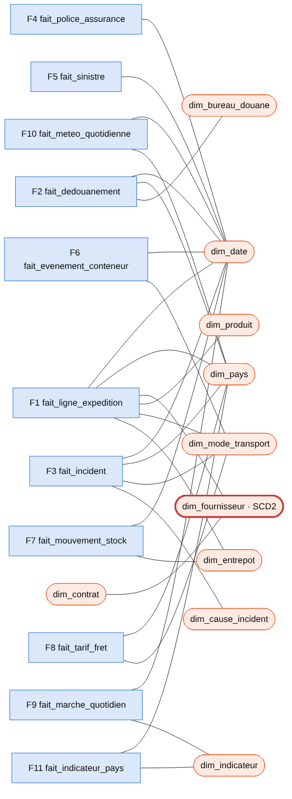
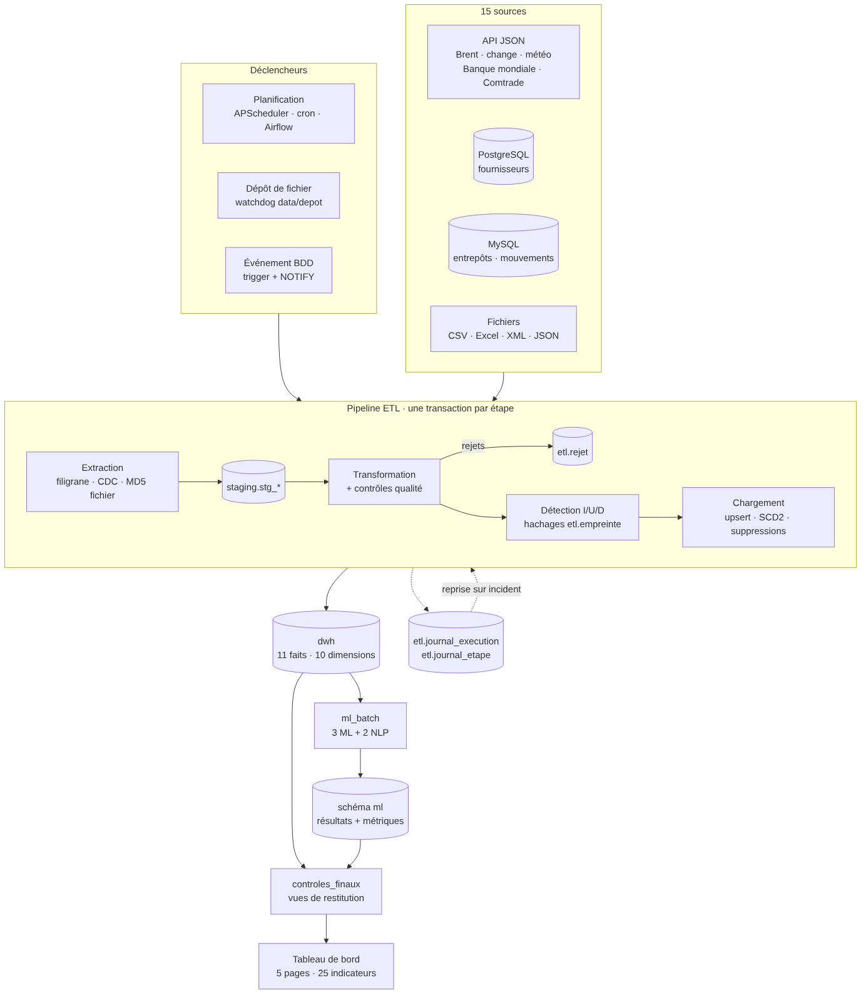

# 1. Contexte et besoins

## 1.1 Contexte

Le programme SCMS (*Supply Chain Management System*, financé par l'USAID) achète et achemine des antirétroviraux, des tests
de diagnostic du VIH et des antipaludiques vers une trentaine de pays, principalement en Afrique subsaharienne. Les
commandes partent soit directement du fabricant (*Direct Drop*), soit de trois centres de distribution régionaux
(Johannesburg, Nairobi, Accra). Chaque expédition traverse une chaîne d'acteurs : fournisseur, transitaire,
transporteur, douane, assureur, magasin central du pays.

La direction des achats veut **suivre les expéditions et les achats internationaux** : coûts, délais, performance des
fournisseurs et risques (douane, incidents, météo, pays). Elle veut aussi **anticiper** grâce au Machine Learning et
**exploiter les textes libres** (contrats, rapports d'incident) grâce au NLP.

## 1.2 Besoins décisionnels (questions métier)

| Domaine | Questions auxquelles l'entrepôt doit répondre |
|---|---|
| Pilotage global | Combien d'expéditions, pour quelle valeur et quel coût ? Livre-t-on à temps ? |
| Expéditions | Quels modes, pays et produits pèsent le plus ? Quel écart entre délai réel et contractuel ? |
| Fournisseurs | Qui est fiable ? Qui concentre le marché ? Qui risque de dériver l'an prochain ? Quelles pénalités prévoient les contrats ? |
| Coûts et fret | Combien coûte un kilo transporté ? Quel surcoût dû au carburant et au change ? Y a-t-il de la surfacturation ? |
| Douanes et risques | Où le dédouanement est-il lent ? Combien d'incidents et de sinistres ? Quels pays sont risqués ? Quel poids pour la météo ? |

## 1.3 Utilisateurs

- **Directeur·rice des achats** : page Synthèse, pages Fournisseurs et Coûts.
- **Responsable logistique / transit** : pages Expéditions, Douanes et risques.
- **Contrôle de gestion** : coûts, change, carburant, anomalies de prix.
- **Équipe data** : journal ETL, rejets, métriques des modèles.

# 2. Sources de données (15 sources, 6 formats)

| N° | Source | Format · origine | Accès / extraction | Lignes (échelle 1) | Clé naturelle | Incrémental |
|---|---|---|---|---|---|---|
| 1 | Supply Chain Shipment Pricing Data (SCMS) | CSV · Kaggle | fichier(s) `data/sources/scms/*.csv` | 9 872 | `ID` | hachage des lignes + hachage MD5 des fichiers |
| 2 | Tarifs de fret | Excel · généré | feuille `Tarifs` | 16 205 | année + origine + destination + mode | hachage |
| 3 | Taux de change | API REST JSON (BCE / frankfurter) | `api.frankfurter.app` | 15 654 (+ FCFA dérivé) | date + devise | filigrane date (−7 j) |
| 4 | Prix du pétrole (Brent) | API REST JSON (EIA v2) | `api.eia.gov` (clé gratuite) | 2 609 | date | filigrane date (−7 j) |
| 5 | Logistics Performance Index | Excel · Banque mondiale | 5 feuilles (2007-2016) | 170 × 7 composantes | pays + année + composante | hachage |
| 6 | Indicateurs pays | API REST JSON (Banque mondiale v2) | 4 indicateurs | 1 360 | pays + année + indicateur | hachage |
| 7 | UN Comtrade (importations SH 3004) | API REST JSON | `comtradeapi.un.org` (clé gratuite) | 340 × 2 mesures | pays + année + mesure | hachage |
| 8 | Fournisseurs | PostgreSQL · généré | base `src_fournisseurs` | 36 | `code_fournisseur` | filigrane `updated_at` + CDC des suppressions |
| 9 | Contrats | XML · généré | `contrats_fournisseurs.xml` (texte libre) | 192 | `id_contrat` | hachage |
| 10 | Incidents de transport | CSV · généré | `incidents_transport*.csv` (texte libre) | 3 872 | `id_incident` | hachage + fichiers nouveaux |
| 11 | Délais de dédouanement | CSV · généré | `dedouanement.csv` (commentaire libre) | 7 030 | `id_dedouanement` | hachage |
| 12 | Entrepôts régionaux | MySQL · généré | base `src_entrepots` (2 tables) | 17 + 350 000 | `code_entrepot`, `id_mouvement` | filigrane `updated_at` + CDC |
| 13 | Suivi des conteneurs | JSON · généré | 119 fichiers mensuels | 629 863 | `id_evenement` | MD5 fichier puis hachage |
| 14 | Assurance cargo | Excel · généré | feuilles `Polices` et `Sinistres` (texte libre) | 6 473 + 370 | `numero_police`, `numero_sinistre` | hachage |
| 15 | Météo | API REST JSON (Open-Meteo archive) | 34 capitales, quotidien | 124 168 | date + pays | filigrane date (−7 j) |

**Formats :** CSV, Excel, JSON/API, XML, PostgreSQL, MySQL, soit **6 formats** (minimum exigé : 4).
**Volume total :** environ **1,2 million de lignes** à l'échelle 1. Les générateurs se règlent avec `ECHELLE` (`ECHELLE=3` donne environ 3,4 millions de lignes).
**Textes libres :** contrats (XML), descriptions d'incidents (CSV), commentaires de douane, descriptions de sinistres (Excel) et commentaires d'audit fournisseur (PostgreSQL), en français avec une part d'anglais.

> **Note sur les sources publiques.** Le jeu Kaggle et les API publiques sont lus tels quels quand ils sont
> disponibles. Il suffit de déposer le fichier Kaggle dans `data/kaggle/` et de lancer les API en ligne. Pour que le projet
> fonctionne sans réseau, le code contient aussi **des instantanés de secours** au format exact de chaque réponse d'API, ainsi
> qu'**une réplique synthétique** du jeu SCMS (mêmes 33 colonnes, mêmes domaines de valeurs, mêmes défauts de saisie). Quand
> une API ne répond pas, l'extraction bascule automatiquement sur l'instantané et le journal le signale (`origine=cache`).

# 3. Matrice des processus × dimensions

Chaque processus métier devient une table de faits. Les dimensions sont **conformes**, c'est-à-dire partagées entre
faits, ce qui donne un **schéma en constellation**.

| Processus (table de faits) | Date | Pays | Fourn. | Prod. | Mode | Entr. | Douane | Cause | Indic. | Contrat |
|------------------------------|------|----|----|----|----|----|----|----|----|-----|
| F1 Lignes d'expédition | ✔ ¹ | ✔ | ✔ ² | ✔ | ✔ | ✔ | | | | ✔ ³ |
| F2 Dédouanement | ✔ ¹ | ✔ | | | | | ✔ | | | |
| F3 Incidents de transport | ✔ | ✔ | | | ✔ | | | ✔ | | |
| F4 Polices d'assurance | ✔ | | | | | | | | | |
| F5 Sinistres cargo | ✔ | | | | | | | | | |
| F6 Événements conteneurs | ✔ | | | | ✔ | | | | | |
| F7 Mouvements de stock | ✔ | | | | | ✔ | | | | |
| F8 Tarifs de fret | ✔ ⁴ | ✔ | | | ✔ | | | | | |
| F9 Marchés (Brent, change) | ✔ | | | | | | | | ✔ | |
| F10 Météo quotidienne | ✔ | ✔ | | | | | | | | |
| F11 Indicateurs pays | ✔ ⁴ | ✔ | | | | | | | ✔ | |

¹ dimension de rôle : 6 dates pour F1 (cotation, commande, référence, prévue, livraison, enregistrement), 3 pour F2 (arrivée, dépôt, mainlevée). ² dimension SCD de type 2. ³ via le code fournisseur. ⁴ au grain de l'année.

Les faits F1 à F6 partagent aussi la **dimension dégénérée `asn_dn`** (numéro d'expédition). C'est elle qui permet le
« forage croisé » (*drill-across*) entre lignes, douane, incidents, assurance et suivi.

# 4. Modèle de l'entrepôt

## 4.1 Granularité (justification)

| Fait | Grain | Justification |
|---|---|---|
| F1 `fait_ligne_expedition` | une ligne de commande SCMS | Grain le plus fin disponible. Il permet l'analyse par produit et la détection d'anomalies de prix ligne à ligne. L'expédition s'obtient en agrégeant sur `asn_dn`. |
| F2 `fait_dedouanement` | un dossier de douane | Un dossier par expédition. Il porte les délais (arrivée → dépôt → mainlevée) et les frais. |
| F3 `fait_incident` | un incident | Plusieurs incidents possibles par expédition. Il porte le texte libre utilisé par le NLP 2. |
| F4 / F5 | une police / un sinistre | Deux processus distincts : la prime est connue à l'avance, le sinistre arrive plus tard. |
| F6 `fait_evenement_conteneur` | un événement de suivi | Positions GPS et températures. C'est la table la plus volumineuse (≈ 630 000 lignes). |
| F7 `fait_mouvement_stock` | un mouvement | Activité des entrepôts régionaux (≈ 350 000 lignes). |
| F9 / F10 | jour × série / jour × pays | Granularité native des API, jointe aux expéditions à la date de commande. |
| F11 | pays × année × indicateur | Les indicateurs annuels (LPI, Banque mondiale, Comtrade) sont stockés dans une structure générique (modèle EAV maîtrisé par `dim_indicateur`). |

## 4.2 Schéma en constellation

{width=42%}

## 4.3 Dimensions

- **`dim_date`** (2000-2030, plus un membre « inconnu » `-1`) : année, semestre, trimestre, mois, semaine ISO, jour, nom
  du jour, week-end. Elle joue **6 rôles** dans F1 : cotation, commande, référence, prévue, livraison, enregistrement.
- **`dim_fournisseur` : dimension à variation lente de type 2.** Les attributs historisés sont la note qualité, la catégorie de risque, la
  certification, la catégorie, le pays, la ville, le délai de paiement et la devise. Leur changement **ferme la version courante**
  (`date_fin_validite`, `est_courant = faux`) et **ouvre une nouvelle version** (`version + 1`). Le commentaire d'audit, lui, est
  géré en **type 1** (écrasement). Une suppression à la source ferme la version et positionne `est_supprime_source = vrai` :
  l'historique reste disponible pour les faits déjà chargés. Un fait est rattaché à la version courante au moment de son chargement.
- `dim_pays` (34 destinations, pays d'origine des fournisseurs et membre inconnu), `dim_produit`, `dim_mode_transport`,
  `dim_entrepot` (type 1, avec indicateur de suppression), `dim_contrat` (avec le texte du contrat), `dim_bureau_douane`,
  `dim_cause_incident`, `dim_indicateur`.
- **Membres inconnus** (`-1`) dans chaque dimension : une clé étrangère n'est jamais nulle, et un fait n'est jamais perdu
  à cause d'une référence absente.

## 4.4 Schémas de la base `dwh_scms`

| Schéma | Rôle |
|---|---|
| `staging` | Zone de transit : copie brute en texte de chaque extraction (`stg_<source>`), avec le numéro d'exécution, pour la traçabilité et le rejeu |
| `dwh` | Entrepôt : dimensions, faits, vue matérialisée `mv_expedition` et vues de restitution `v_*` |
| `etl` | Pilotage : `journal_execution`, `journal_etape`, `rejet`, `filigrane`, `empreinte` (hachages), `fichier_traite` |
| `ml` | Résultats des modèles : prédictions, scores, anomalies, clauses, classes et `metrique_modele` |

# 5. Plan des flux ETL

## 5.1 Étapes d'une exécution

Une exécution enchaîne **20 étapes** : `referentiels`, les 17 sources dans l'ordre des dépendances (marchés et indicateurs,
puis dimensions, puis faits), puis `ml_batch` et `controles_finaux`. Chaque étape est **une transaction** qui suit ce cycle :

1. **Extraction** : lecture de la source (complète ou incrémentale, voir § 6).
2. **Staging** : écriture brute dans `staging.stg_<source>`.
3. **Transformation et contrôles qualité** : typage, normalisation et règles (§ 5.2). Les lignes rejetées vont dans `etl.rejet` avec la règle, le motif et la ligne complète en JSONB.
4. **Détection des changements** : comparaison des hachages avec `etl.empreinte` → I (nouvelle), U (modifiée), D (supprimée).
5. **Chargement** : recherche des clés de substitution, puis `INSERT … ON CONFLICT DO UPDATE` (via `COPY` dans une table temporaire), suppressions et SCD2.
6. **Mise à jour de l'état incrémental** : empreintes, fichiers traités et filigrane, **dans la même transaction** que le chargement.

## 5.2 Contrôles qualité (exemples réellement déclenchés au premier chargement)

| Règle | Exemple | Rejets |
|---|---|---|
| `doublon` (exact ou sur la clé) | 12 lignes dupliquées dans le CSV SCMS, 25 dans les tarifs | 37 |
| `valeur_manquante` | 40 tarifs vides, 25 dossiers de douane sans date d'arrivée, 15 incidents sans description | 80 |
| `incoherence` | 30 dossiers dont la mainlevée précède l'arrivée | 30 |
| `format_invalide` | prix négatifs, coordonnées GPS hors plage, note qualité hors 1-5, LPI hors 1-5 | 0 (règle active) |
| `reference_inconnue` | pays absent du référentiel | 0 (règle active) |
| **Total** | | **147 rejets journalisés** |

Les valeurs non numériques propres au jeu SCMS sont **interprétées, pas rejetées** : `Pre-PQ Process`, `Date Not Captured`,
`Weight Captured Separately`, `See ASN-93 (ID#:1281)`, `Freight Included in Commodity Cost`. Le poids et le fret, saisis sur
la première ligne de l'expédition, sont **ventilés** sur les lignes au prorata de la valeur.

## 5.3 Gestion des erreurs et reprise sur incident

- **Relance automatique** des appels d'API (2 tentatives, attente exponentielle), puis **repli sur l'instantané**.
- **Une transaction par étape** : en cas d'erreur, l'étape est annulée (`ROLLBACK`) et marquée `ECHEC` avec le message. L'exécution passe en `ECHEC`.
- **Reprise** (`python run.py reprise`) : une nouvelle exécution est liée à la précédente (`reprise_de`). Les étapes déjà réussies sont marquées `IGNOREE` et le traitement repart **à l'étape en échec**. Les étapes sont idempotentes (upsert et empreintes), donc rejouer une étape ne crée jamais de doublon.
- **Verrou** (`pg_advisory_lock`) : deux exécutions ne peuvent pas tourner en même temps. Un déclencheur concurrent **attend son tour** au lieu d'être perdu.
- **Panne simulable** pour la démonstration : `ETL_PANNE=<étape>`.
- **Contrôles finaux** : faits sans pays ou sans fournisseur, fournisseurs avec plusieurs versions courantes, dossiers de douane orphelins.

# 6. Chargement incrémental

| Type de source | Mécanisme | Suppressions |
|---|---|---|
| PostgreSQL, MySQL | **Colonne de filigrane** `updated_at` (mise à jour par trigger / `ON UPDATE`) : `WHERE updated_at > filigrane` | **CDC** : les triggers `AFTER DELETE` alimentent `journal_suppressions` |
| Fichiers (CSV, Excel, XML, JSON) | **MD5 du fichier** (un fichier inchangé n'est pas relu), puis **hachage de chaque ligne** comparé à `etl.empreinte` | Clés présentes dans l'empreinte du fichier relu mais absentes de sa nouvelle version, ou fichier disparu |
| API datées | **Filigrane date** (dernière date chargée, relue avec 7 jours de recul pour capter les révisions) | sans objet |
| API annuelles | relecture complète et comparaison de hachages (petits volumes) | clés absentes |

**Démonstration** (`python run.py demo`, résultats réels) :

| Exécution | Ce qui se passe | Résultat |
|---|---|---|
| 1. Complet | Premier chargement | **1 171 546 lignes insérées**, 147 rejets, environ 80 s |
| 2. Simulation | +2 / ~4 / −1 fournisseurs ; +1 500 / ~200 / −100 mouvements ; nouveau fichier SCMS, 20 lignes modifiées et 10 supprimées ; douane, conteneurs, incidents | — |
| 3. Incrémental | Détection des changements | **1 742 I, 242 U, 111 D.** 3 fournisseurs passent en version 2 (SCD2), le fournisseur supprimé est fermé |
| 4. Incrémental sans changement | Fichiers inchangés ignorés | **0 I / 0 U / 0 D** |
| 5a. Panne simulée | `csv_incidents` échoue | exécution en `ECHEC`, 14 étapes réussies |
| 5b. Reprise | Reprend à `csv_incidents` | 14 étapes `IGNOREE`, **30 incidents chargés**, `SUCCES` |

# 7. Déclenchement automatique (3 mécanismes, 2 exigés)

| Mécanisme | Mise en œuvre | Testé |
|---|---|---|
| **Planification** | `declencheurs/planificateur.py` (APScheduler : ETL chaque nuit à 02:00, ML le dimanche à 03:00). Alternatives fournies : `crontab.txt` (cron et Planificateur de tâches Windows) et `dags/scms_etl_dag.py` (Apache Airflow) | ✔ exécution toutes les minutes en démonstration |
| **Dépôt de fichier** | `declencheurs/surveillance_dossier.py` (watchdog) : un fichier déposé dans `data/depot/` est reconnu par son nom, archivé, déplacé, puis l'ETL de **cette seule source** est lancé | ✔ `incidents_transport_2016_01.csv` → 30 incidents chargés |
| **Événement base de données** | Trigger PostgreSQL `trg_fournisseur_notify` → `pg_notify('etl_fournisseurs', …)`. `declencheurs/ecouteur_bdd.py` (`LISTEN`, anti-rebond de 5 s) lance l'ETL de `pg_fournisseurs` | ✔ `UPDATE` et `DELETE` propagés en quelques secondes |

Chaque exécution enregistre son **déclencheur** et le détail associé (nom du fichier, opérations SQL) dans `etl.journal_execution`.

# 8. Indicateurs (25) — définitions

| # | Page | Indicateur | Définition / calcul |
|---|---|---|---|
| 1 | Synthèse | Nombre d'expéditions | `count(distinct asn_dn)` |
| 2 | Synthèse | Coût total | fret + coût d'assurance + frais de douane |
| 3 | Synthèse | Délai moyen de livraison | date de livraison − date de référence (envoi du bon de commande, à défaut 1re cotation) |
| 4 | Synthèse | Taux de livraison à temps | part des expéditions livrées au plus tard à la date prévue |
| 5 | Synthèse | Valeur transportée | Σ valeur des lignes |
| 6 | Expéditions | Expéditions par mode de transport | répartition par `dim_mode_transport` |
| 7 | Expéditions | Expéditions par pays | répartition par `dim_pays` |
| 8 | Expéditions | Expéditions par produit | répartition par groupe de produits |
| 9 | Expéditions | Poids moyen par expédition | moyenne du poids (kg) des expéditions dont le poids est saisi |
| 10 | Expéditions | Écart délai réel / contractuel | moyenne de (livraison − date prévue), en jours |
| 11 | Fournisseurs | Performance par fournisseur | taux à temps et écart moyen par fournisseur |
| 12 | Fournisseurs | Taux de conformité | expéditions à temps **et** sans incident majeur ou critique |
| 13 | Fournisseurs | Part de marché des fournisseurs | valeur du fournisseur / valeur totale |
| 14 | Fournisseurs | Délai de réponse | envoi du bon de commande − 1re demande de cotation |
| 15 | Fournisseurs | Nombre de fournisseurs à risque | score ML 2 ≥ 0,5 (dernière année connue) |
| 16 | Coûts et fret | Coût par kilogramme | Σ fret facturé / Σ poids |
| 17 | Coûts et fret | Coût de fret par mode | Σ fret par mode et coût au kilo par mode |
| 18 | Coûts et fret | Surcoût lié au carburant | part BAF du fret : `fret × b / (1 + b)` avec `b = max(0 ; (Brent − 60) × 0,15 %)` |
| 19 | Coûts et fret | Effet du taux de change | coût en EUR au taux du jour − coût au taux budgété (moyenne USD/EUR de l'année précédente), aussi exprimé en FCFA (parité 655,957) |
| 20 | Coûts et fret | Coût d'assurance | primes des polices cargo (à défaut, assurance SCMS) ; taux sur la valeur |
| 21 | Douanes et risques | Délai de dédouanement | mainlevée − arrivée |
| 22 | Douanes et risques | Incidents pour 1 000 expéditions | nb d'incidents / nb d'expéditions × 1 000 |
| 23 | Douanes et risques | Sinistres cargo | nombre, montant réclamé et montant indemnisé |
| 24 | Douanes et risques | Indice de risque pays (0-100) | 40 % × (5 − LPI) / 4 + 30 % × (2,5 − stabilité politique) / 5 + 30 % × délai de dédouanement normalisé |
| 25 | Douanes et risques | Retards dus à la météo | expéditions en retard ayant au moins un incident « Météo » (cause déclarée ou prédite par NLP 2), rapprochées des précipitations Open-Meteo |

# 9. Machine Learning et NLP (3 ML + 2 NLP)

Les modèles sont entraînés **en Python, hors de l'outil de visualisation**, par l'étape planifiée `ml_batch` de l'ETL
(ou par `python run.py ml`). Leurs résultats et **métriques d'évaluation** sont écrits dans le schéma `ml`, puis affichés
dans le tableau de bord.

| Type | Fonctionnalité | Méthode | Évaluation | Résultat | Page |
|---|---|---|---|---|---|
| ML | Prédiction du coût et du délai d'une expédition | 2 × `HistGradientBoostingRegressor` (variables : mode, pays, origine, produit, poids, valeur, Brent, LPI, délai prévu) ; simulateur interactif | test 20 % | coût : R² (log) = 0,84, erreur absolue moyenne ≈ 710 $ ; délai : R² = 0,90, MAE = 9 j | Expéditions |
| ML | Score de risque fournisseur | `RandomForestClassifier` sur un panel fournisseur × année ; cible = conformité < 80 % l'année suivante | validation croisée à 5 plis | AUC = 0,61 ; précision = 0,58 ; rappel = 0,54 | Fournisseurs |
| ML | Détection d'anomalies de prix et de surfacturation | `IsolationForest` sur l'écart au prix médian (produit × année, fournisseur) | vérité terrain (anomalies injectées) | précision 0,97 ; rappel 1,00 ; F1 0,98 | Coûts et fret |
| NLP | Extraction des clauses, pénalités et échéances des contrats | spaCy `fr_core_news_sm` + `Matcher` + expressions régulières (chiffres en lettres, dates en toutes lettres) | vérité terrain, 8 champs | précision 1,00 ; rappel 0,95 ; F1 0,97 | Fournisseurs |
| NLP | Classification des incidents par cause | TF-IDF (mots 1-2 grammes + caractères 3-5 grammes) + régression logistique ; prédit la cause des 35 % d'incidents non déclarés | test stratifié 20 % | exactitude 81 % ; F1 macro 0,80 ; 86 % sur les non déclarés | Douanes et risques |

**Lecture critique.**

- Le score de risque fournisseur reste modeste. Le signal est faible, car il y a peu d'expéditions par fournisseur et par an, et le pays de destination pèse davantage que le fournisseur dans les retards. Une piste d'amélioration est d'ajouter des variables d'audit et de capacité de production.
- Le NLP sur les contrats atteint ses limites sur les textes mal numérisés (« penalite » sans accent, « 45 j. »). Ces contrats sont signalés comme « sans pénalité détectée » pour une vérification manuelle.
- Les incidents décrits de façon vague sont la principale source d'erreur du classifieur.

# 10. Restitution

Le tableau de bord est construit avec **Streamlit et Plotly**, un outil équivalent accepté par l'énoncé. Il contient
**5 pages** (Synthèse + 4 domaines) et une **navigation** dans la barre latérale. Ses **filtres communs** (période, pays,
mode, groupe de produits) restent actifs d'une page à l'autre. Chaque page affiche un **indicateur d'actualité**
(date et heure du dernier chargement réussi, mode et déclencheur), lu dans `etl.v_fraicheur`. Les 25 indicateurs sont
numérotés selon l'énoncé.

Les vues `dwh.v_expedition`, `dwh.v_risque_pays` et `dwh.v_fournisseur_annee` peuvent aussi être branchées directement sur
Power BI ou Metabase.

# 11. Livrables et arborescence

| Livrable | Emplacement |
|---|---|
| Dossier de conception | `docs/dossier_conception.md` / `.docx` |
| Scripts et jobs ETL versionnés | dépôt Git : `etl/`, `sql/`, `generateurs/`, `declencheurs/`, `ml/` |
| Entrepôt chargé | base PostgreSQL `dwh_scms` (`python run.py tout`) |
| Tableau de bord | `tableau_de_bord/` (`python run.py tableau`) ; captures dans `docs/captures/` |
| Démonstration incrémental, reprise et déclencheurs | `python run.py demo`, `run.py surveillance`, `run.py ecouteur`, `run.py planificateur --minutes 1` |
